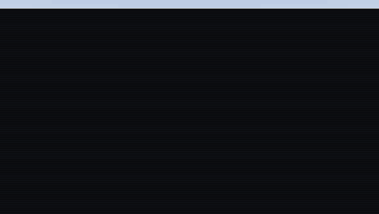
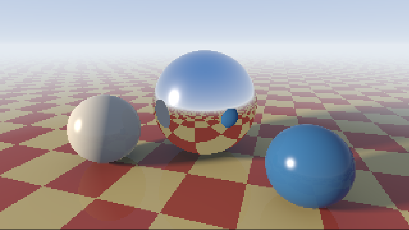
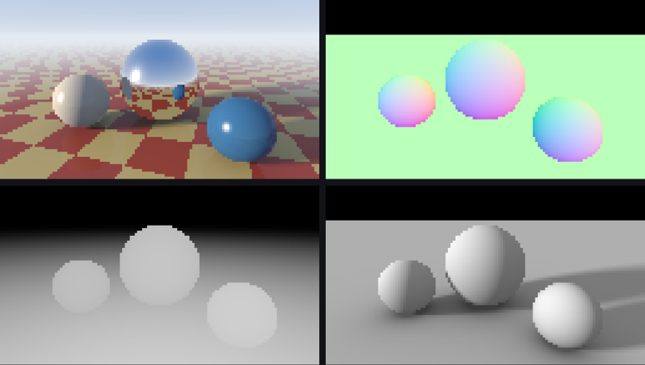

# CSS Ray Tracer

A ray tracer that runs entirely in the browser's style engine. No JavaScript, no WebGL, no canvas, no images: every pixel is an `<i>` element, and its color is the result of about 75 chained `@property` values computed with `sqrt()`, `pow()`, `exp()`, `hypot()`, `sign()`, `sin()` and `sibling-index()`.

**Live demo:** https://marco-jardim.github.io/css-raytracer/



The scene is a tribute to Turner Whitted's 1980 image, the first to trace recursive reflections: a mirror ball and two diffuse spheres over a red and yellow checkerboard, with soft shadows, ambient occlusion, Fresnel reflections on the floor, fog and a sky with a sun.



<sub>The 320×180 preset: 57,600 elements, each one solving its own ray.</sub>

---

## Contents

- [What it does](#what-it-does)
- [Browser support](#browser-support)
- [How it works](#how-it-works)
- [Performance](#performance)
- [Things we learned about Chromium along the way](#things-we-learned-about-chromium-along-the-way)
- [Project layout](#project-layout)
- [Building](#building)
- [Previewing and benchmarking](#previewing-and-benchmarking)
- [Deploying to GitHub Pages](#deploying-to-github-pages)
- [Customizing the scene](#customizing-the-scene)
- [Credits](#credits)

---

## What it does

- **Primary rays** from a pinhole camera through every pixel.
- **Ray/sphere intersection** against three spheres and **ray/plane** against the floor, picking the nearest hit.
- **Soft shadows** from an analytic closest-approach penumbra, one test per sphere.
- **Ambient occlusion** on the floor from the analytic solid angle of each sphere.
- **A second bounce:** the reflected ray is traced again against all spheres and the floor, so the mirror ball shows the checkerboard, the other spheres, the sky and the sun.
- **Fresnel** (Schlick) reflections on the floor and on the diffuse spheres.
- **Exponential fog** and a sky gradient with a sun disc and glow.
- **Gamma correction** before the color reaches `background-color`.

Everything is driven by form controls styled as a render panel, wired with `:has()`:

| Control | Options |
| --- | --- |
| Camera | 6 stations on a top-down plan of the scene, plus Grazing / Eye level / High |
| Sun | Late afternoon, Afternoon, Noon, Backlight |
| Center sphere | Chrome, Gold, Clay |
| Render pass | Beauty, Normals, Depth, Lighting |
| Resolution | 64×36 up to 320×180 (see [presets](#resolution-presets)) |
| Display | Smooth (CRT blur), Show grid (one cell per element), Fast scan, Moving sun |



The stats bar under the image is also pure CSS: `counter()` counts the pixel and scanline elements that are currently rendered.

---

## Browser support

Chrome and Edge **138 or later** (Chromium). Browsers without `sibling-index()` show a notice instead of the render.

| Feature | First Chromium version |
| --- | --- |
| `sibling-index()`, `sibling-count()` | 138 |
| `sign()`, `abs()` | 138 |
| `round()`, `mod()` | 125 |
| `exp()`, `pow()`, `sqrt()`, `hypot()` | 120 |
| `sin()`, `cos()` | 111 |
| `display` inside `@keyframes` | 116 |
| `:has()` | 105 |
| `@property` | 85 |

The project was built and measured in headless Chromium 141.

---

## How it works

### 1. One element per pixel

Each framebuffer is a grid of rows (`<b>`) holding pixels (`<i>`):

```html
<div class="fb fb-96">
  <b><i></i><i></i>… 96 pixels …</b>
  … 54 rows …
</div>
```

`sibling-index()` and `sibling-count()` give every element its own coordinates, so the same stylesheet works for every resolution. There is one framebuffer per preset in the HTML; only the selected one is displayed.

### 2. Registered properties as a dataflow graph

Every intermediate value is registered as a number, so the browser stores a computed value instead of re-expanding text:

```css
@property --tm { syntax: '<number>'; inherits: false; initial-value: 0; }
```

Work is split in two levels (see [`src/scene.py`](src/scene.py)):

- **Per scanline** (`<b>`, 29 properties): camera basis from the yaw and pitch, eye position, sun direction, the constant term of each ray/sphere quadratic, and the part of the primary ray that depends only on the row. These are `inherits: true`, so every pixel in the row reads them.
- **Per pixel** (`<i>`, 75 properties): everything else, ending in `--Or`, `--Og`, `--Ob`.

```css
--u:  calc((2 * sibling-index() - 1 - sibling-count()) / var(--hh));
--rl: hypot(var(--rx), var(--qy), var(--rz));
--dx: calc(var(--rx) / var(--rl));
```

### 3. Branching without `if`

A ray misses a sphere when the discriminant of the quadratic is negative. Instead of a conditional, `sign()` adds a huge distance to misses, and `min()` picks the nearest surface:

```css
--e0: calc(sqrt(max(var(--b0) * var(--b0) - var(--c0), 0)) * -1 - var(--b0)
      + 1e5 * max(0, sign(var(--c0) - var(--b0) * var(--b0))));
--tm: min(var(--e0), var(--e1), var(--e2), var(--ef));
--i0: calc(1 + sign(var(--tm) - var(--e0)));   /* 1 if sphere 0 is the nearest hit */
```

The one-hot masks (`--i0`, `--i1`, `--i2`, `--if`) then select the normal, albedo and reflectivity of whatever was hit.

### 4. Shading

- **Soft shadows.** For each sphere, the closest approach between the sun ray and the sphere center gives a penumbra that widens with distance, `clamp()`ed into `[0, 1]`.
- **Ambient occlusion.** The floor is darkened by each sphere's solid angle, `cy · r² / |P − C|³`, written as `pow(d², 1.5)`.
- **Reflection.** `m = d − 2(d·n)n` is traced again against all three spheres and the floor (a hit needs a positive discriminant and the sphere in front of the ray).
- **Fresnel.** `pow(1 - abs(d·n), 5)` blends reflections in at grazing angles.
- **Fog.** `exp(-0.07 · max(0, t − 7))` fades the floor into the horizon.
- **Sky and sun.** A gradient from `sqrt(max(d.y, 0))`, plus `pow(d·L, 900)` for the disc and `pow(d·L, 12)` for the glow.

### 5. Render passes

The final expression is a weighted sum of four outputs (beauty, normals, depth, lighting). The pass control only changes the weights, so the AOVs come from the same computation.

### 6. The scanline scheduler

Styling every pixel at once would freeze the tab for seconds, so the image is drawn one row at a time:

```css
.fb > b {
  animation-name: var(--a-cam), var(--a-hgt), var(--a-sun), var(--a-mat), var(--a-pas), …;
  animation-duration: 1ms;
  animation-fill-mode: backwards;
  animation-delay: calc(sibling-index() * var(--step) + 120ms);
}
@keyframes rv-mat-m1 { from, to { display: none } }
```

Each row is held at `display: none` until its delay ends. **Elements inside a `display: none` subtree are not styled at all**, so hidden rows cost nothing, and each frame only resolves the rows that just appeared.

Every control group owns one entry in that animation list. Picking an option makes `:has()` swap the entry's name, and a new name restarts the animation:

```css
.app:has(#m1:checked) .fb > b { --mr: .12; --mg: .07; …; --a-mat: rv-mat-m1; }
```

The whole frame drops to `display: none` in the same style pass that changes the inputs, so the click itself stays cheap and the new image is drawn from the top.

### 7. Moving sun

With **Moving sun** on, each row gets one more animation that steps `--sun` by 15° with `steps(24)`, offset by the row index. Rows update one after another, so the frame redraws continuously as a rolling sweep.

---

## Performance

On a 2.8 GHz Xeon VM, Chromium spends about **0.7 ms of style work per pixel**: roughly 1 µs per registered property plus about 0.2 µs per token in its expression. A 96×54 frame is about 3.6 s of CPU, which rules out real-time animation and is why the page renders progressively.

The scheduler gives each row a fixed time budget, `MS_PER_PX × width` (0.72 ms per pixel by default). If a machine is faster than that, rows arrive at a steady pace and the page stays responsive. If it is slower, more rows become due during each long frame and they arrive in bursts. **Fast scan** halves the budget for fast machines.

### Resolution presets

| Preset | Elements | Budget per scanline | Frame time | With Fast scan |
| --- | ---: | ---: | ---: | ---: |
| 64×36 | 2,304 | 46 ms | ~1.8 s | ~0.9 s |
| 96×54 (default) | 5,184 | 69 ms | ~3.8 s | ~2.0 s |
| 128×72 | 9,216 | 92 ms | ~6.7 s | ~3.4 s |
| 160×90 | 14,400 | 115 ms | ~10.5 s | ~5.3 s |
| 192×108 | 20,736 | 138 ms | ~15.0 s | ~7.6 s |
| 256×144 | 36,864 | 184 ms | ~26.6 s | ~13.4 s |
| 320×180 | 57,600 | 230 ms | ~41.5 s | ~20.8 s |

The page ships all presets as plain HTML: about 1.1 MB, around 16 KB gzipped, which GitHub Pages compresses automatically.

---

## Things we learned about Chromium along the way

These were observed in Chromium 141 while building the project.

- **Synthetic benchmarks lie.** Pixels whose parent rows have identical inherited values share entries in the MatchedPropertiesCache, so a test grid with uniform rows can look 40× cheaper than a real image where every row differs.
- **A transition on an inherited custom property restyles every descendant immediately**, even while the transition is still waiting out its `transition-delay` and the visible value has not changed. That ruled out delayed transitions as a per-row gate.
- **Changing a non-inherited registered property on a parent does not restyle its children**; changing an inherited one does.
- **`display: none` subtrees are skipped by style recalc**, which is what makes the scanline scheduler work.
- **`mod(-4, 2)` returns `2` instead of `0`**, apparently because of the sign of a negative zero. The checkerboard adds `1e6` before taking `mod()`.
- **`container-type` implies style containment**, which scopes CSS counters to the container. The live counters broke until it was removed from the frame.
- **Flex rows stretch while hidden siblings are missing.** Rows are positioned absolutely from `sibling-index()` so each scanline stays where it belongs during the reveal.
- **`:has()` invalidation walks the subtree.** With ~146,000 elements in the page, a click spends about 150 ms in invalidation even though only the rows change.

---

## Project layout

```
.
├── index.html        Generated page. GitHub Pages serves this file.
├── .nojekyll         Tells GitHub Pages to publish the files as they are.
├── src/
│   ├── scene.py      Scene constants and the ray tracing math, as CSS expressions.
│   └── build.py      Presets, UI, scheduler and HTML. Writes index.html.
├── tools/
│   └── preview.py    Headless Chromium preview: PNG stills, GIF, frame timings.
└── docs/             Images used in this README.
```

---

## Building

The build needs only Python 3.9+ and the standard library:

```sh
python3 src/build.py
```

It writes `index.html` at the repository root. Commit the regenerated file whenever you change anything under `src/`, because that file is what GitHub Pages publishes.

To check the math without building the page:

```sh
python3 src/scene.py
# 29 row properties, 74 pixel properties, 1776 pixel tokens
```

---

## Previewing and benchmarking

Open `index.html` directly in Chrome; it has no external dependencies apart from Google Fonts.

`tools/preview.py` renders the page in headless Chromium through Playwright:

```sh
pip install playwright pillow
playwright install chromium

python3 tools/preview.py                                  # 96×54 still → docs/screenshot.png
python3 tools/preview.py --res 320 --out docs/render-320.png
python3 tools/preview.py --res 128 --click v1 --out normals.png   # click controls first
python3 tools/preview.py --gif docs/scanline.gif          # record the scanline reveal
```

It also prints the long animation frames seen during the render. If they keep growing until the image is done, the budget in `MS_PER_PX` is tighter than the machine can keep up with.

---

## Deploying to GitHub Pages

The page is a single static file that is already committed, so **deploying from a branch** is the simplest option: there is nothing to build in CI.

1. Push the repository to GitHub (`marco-jardim/css-raytracer`).
2. Open **Settings → Pages**.
3. Under **Build and deployment → Source**, choose **Deploy from a branch**.
4. Under **Branch**, pick `main` and the `/ (root)` folder, then **Save**.
5. Wait for the `pages-build-deployment` run in the **Actions** tab to finish (usually under a minute).

The site will be at **https://marco-jardim.github.io/css-raytracer/**. Every push to `main` republishes it.

The empty `.nojekyll` file makes Pages skip Jekyll and publish the files as they are.

GitHub Actions would only be worth it if you wanted CI to run `src/build.py` instead of committing `index.html`. In that case, set the Pages source to **GitHub Actions** and use a workflow that runs the build and uploads the repository root as the Pages artifact.

---

## Customizing the scene

Everything lives in two Python files that only emit CSS.

**`src/scene.py`**

| Constant | What it controls |
| --- | --- |
| `SPHERES` | Center and radius of each sphere. Sphere 0 takes its material from the UI. |
| `BLUE`, `CLAY` | Albedo of the two diffuse spheres. |
| `TILE_RED`, `TILE_YELLOW` | Checkerboard colors. |
| `ZENITH`, `HORIZON`, `SUN`, `AMBIENT` | Sky and lighting colors. |
| `TARGET_Y`, `DISTANCE`, `FOCAL` | Camera target height, orbit distance and focal length. |
| `FOG`, `FOG_START` | Fog density and start distance. |

**`src/build.py`**

| Setting | What it controls |
| --- | --- |
| `CAMERAS`, `HEIGHTS`, `SUNS`, `MATERIALS`, `PASSES` | The presets shown in the panel. |
| `RESOLUTIONS`, `DEFAULT_RES` | Framebuffer sizes. Every preset adds its pixels to the HTML. |
| `MS_PER_PX` | Scanline budget per pixel. Raise it if rows arrive in bursts; lower it on fast machines. |

The plan map in the panel reads `SPHERES` too, so it follows any change to the scene.

### Property names at a glance

| Properties | Meaning |
| --- | --- |
| `--dx --dy --dz` | Normalized primary ray direction |
| `--e0 --e1 --e2 --ef` | Distance to each sphere and to the floor (`1e5` = miss) |
| `--tm` | Distance to the nearest hit |
| `--i0 --i1 --i2 --if` | One-hot mask of what was hit (`--if` also covers the sky) |
| `--hx --hy --hz` | Hit point |
| `--nx --ny --nz` | Surface normal |
| `--s0 --s1 --s2` | Soft shadow factor from each sphere |
| `--ls`, `--la` | Direct sun light; ambient light with occlusion |
| `--mx --my --mz` | Reflected ray direction |
| `--g0 --g1 --g2 --gf`, `--rm` | Reflected ray distances and nearest reflected hit |
| `--Rr --Rg --Rb` | Color seen along the reflected ray |
| `--Or --Og --Ob` | Final linear color, gamma-corrected into `background-color` |

---

## Credits

- Turner Whitted, *An Improved Illumination Model for Shaded Display*, Communications of the ACM 23(6), 1980. The scene is a homage to its spheres over a checkerboard.
- Lyra Rebane's [x86CSS](https://lyra.horse/x86css/), an x86 emulator in CSS, showed how far modern CSS math and tree-counting functions can go.
- Fonts: Young Serif, IBM Plex Sans and IBM Plex Mono, served by Google Fonts.
